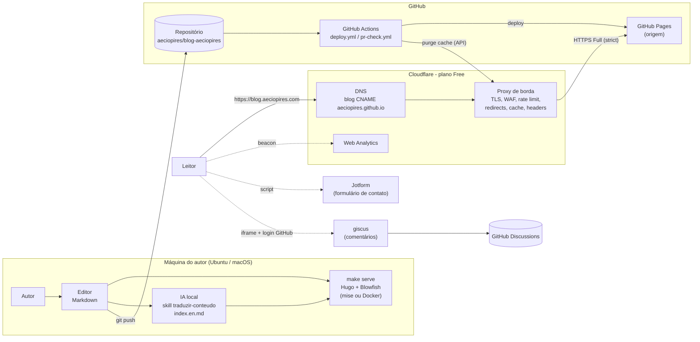
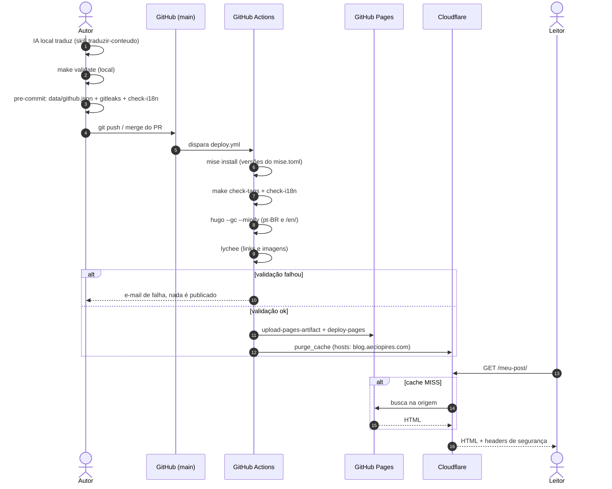
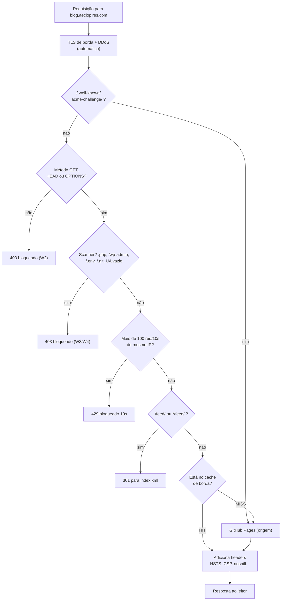
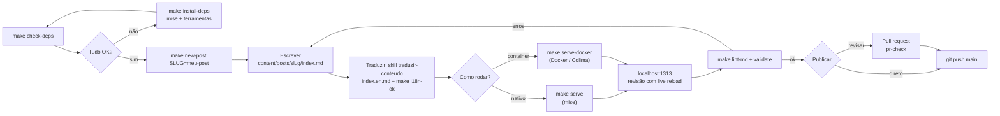
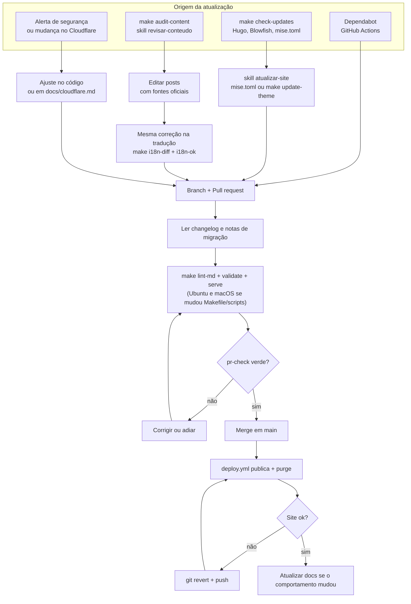

# Arquitetura

Visão do sistema que publica o [blog.aeciopires.com](https://blog.aeciopires.com). As decisões completas e o motivo de cada uma estão em [PLANS/blog-migration/PLAN.md](../PLANS/blog-migration/PLAN.md). Para operar o dia a dia, use o [MAINTENANCE.md](MAINTENANCE.md).

## 1. Visão geral

O blog é um **site estático**: o Hugo gera HTML, CSS e JS a partir de Markdown; o GitHub Pages hospeda; o Cloudflare fica na frente como proxy. Não há servidor de aplicação, banco de dados, login nem formulário próprio.

O site tem dois idiomas: **pt-BR** (padrão e fonte, na raiz) e **en-US** (em `/en/`). A versão em inglês é traduzida **na máquina do autor, antes do commit**, por IA local (skill `traduzir-conteudo` / agente `tradutor-en`), e versionada como `index.en.md` ao lado do original. O build e o navegador não traduzem nada.

## 2. Componentes e responsabilidades

| Componente | Responsabilidade | Onde fica a configuração |
|---|---|---|
| Hugo *extended* | Gera o site | `mise.toml` (versão), `config/_default/` |
| Tema Blowfish | Layouts, CSS, busca (Fuse.js), modo claro/escuro | submódulo `themes/blowfish` (tag fixada) |
| Customizações | Visual T9, banner, nuvem de tags, comentários, analytics | `assets/`, `layouts/`, `data/`, `i18n/` |
| Versão em inglês | Idioma en-US em `/en/` (seletor de idioma, hreflang e sitemap do tema; redirecionamento da home pelo idioma do navegador); garantia de tradução completa, em dia e com os mesmos comandos/links | `config/_default/languages.en.toml`, `menus.en.toml`, `i18n/en.yaml`, `content/**/index.en.md`, `scripts/i18n.mjs`, skill `traduzir-conteudo` |
| mise | Versões exatas das ferramentas (local e CI) | `mise.toml` |
| Make + scripts | Interface única de operação | `Makefile`, `scripts/` |
| pre-commit | Atualiza `data/github.json` e barra segredos, arquivos sensíveis, o e-mail do autor e tradução em inglês ausente/desatualizada; lint dos `.md` alterados | `.githooks/pre-commit` (`make install-hooks`) |
| GitHub Actions | Validação (`pr-check.yml`), publicação (`deploy.yml`: push na `main`, manual, todo 1º de janeiro e toda segunda), certificado (`origin-cert.yml`) | `.github/workflows/` |
| GitHub Pages | Origem: serve os arquivos estáticos | Settings → Pages (fonte: GitHub Actions) |
| Cloudflare Free | DNS, TLS de borda, WAF, rate limit, redirects, cache, headers, Web Analytics | painel; documentado em [cloudflare.md](cloudflare.md) |
| giscus | Comentários novos no GitHub Discussions | `config/_default/params.toml` (`[giscus]`), `layouts/partials/comments.html` |
| Jotform | Formulário de contato | `params.toml` (`[jotform]`), shortcode `jotform` |

### Estrutura do repositório

| Caminho | Conteúdo |
|---|---|
| `content/posts/<slug>/index.md` | Posts (*page bundles*, imagem destacada `feature.*`) |
| `content/posts/<slug>/index.en.md` | Tradução en-US do post (mesmo bundle e imagens; `sourceHash` = hash do pt-BR traduzido) |
| `content/<slug>/index.md` (+ `index.en.md`) | Páginas (Sobre, Cursos, Contato, Privacidade, Créditos) e suas traduções |
| `static/wp-content/uploads/` | Mídias antigas no mesmo caminho do WordPress |
| `data/taxonomia.yaml` | Registro de tags, sinônimos e categorias |
| `data/comments/<slug>.yaml` | Comentários arquivados (somente leitura, sanitizados) |
| `data/tecnologias.yaml` + `assets/img/logos/` | Banner de tecnologias (`nome`, `logo`, `url` e `legenda` opcional) |
| `content/categories/_index.md`, `content/tags/_index.md` | Título em pt-BR das páginas `/categories/` e `/tags/` (sem eles, o Hugo usa o nome interno em inglês) |
| `assets/css/custom.css` | Visual T9 (vidro, banner, nuvem, comentários) e leitura no computador (fonte e largura do texto em telas ≥ 1024px) |
| `assets/js/` | JS próprio (giscus, redirecionamentos legados, ajuste e escape da busca em `busca.js`, ordenação e home leve em `ordenar-home.js`) |
| `js/posts-home.<hash>.json` (gerado) | Dados leves dos posts para a ordenação da home, criado pelo `cardview.html` a partir da saída do tema; validado por `scripts/check-home.mjs` |
| `data/github.json` | Total de repositórios públicos no GitHub (cartão da home); versionado; atualizado por `scripts/github-repos.mjs` no pre-commit, que inclui o arquivo no commit se o número mudar (à mão: `make github-repos`) |
| `data/visualizacoes.json` | Visualizações por página dos últimos 180 dias (gerado no deploy por `scripts/visualizacoes.mjs` a partir do Cloudflare Web Analytics; localmente, `make visualizacoes`; ignorado pelo Git) |
| `layouts/` | Só partials, shortcodes e overrides próprios |
| `docker/lighthouse/Dockerfile` + `scripts/lighthouse.sh` | `make lighthouse`: Lighthouse em Docker contra o site publicado (relatórios em `reports/lighthouse/`) |
| `i18n/pt-BR.yaml` + `i18n/en.yaml` | Só as chaves do tema que mudam (rodapé, "Mais recentes", botão de busca, nomes acessíveis `nav.*` que o Blowfish não traduz) e os textos dos layouts próprios (`blog.*`, mesmas chaves nos dois) |
| `scripts/i18n.mjs` | `make check-i18n`/`i18n-*`: tradução completa, em dia (`sourceHash`) e com comandos, código e links idênticos ao pt-BR |
| `.claude/skills/` | Skills do Claude Code (`blowfish` é link para o submódulo) |

## 3. Fluxo de publicação

Todo push em `main` publica. Se a validação falhar, nada é publicado.

## 4. Caminho de uma requisição no Cloudflare

## 5. Ambiente local

## 6. Ciclo de manutenção

## 7. Decisões e trade-offs

| Decisão | Motivo | Trade-off aceito |
|---|---|---|
| Site estático (Hugo) em vez de WordPress | Sem PHP, banco e plugins: menos superfície de ataque e manutenção | Edição em Markdown + Git |
| Blowfish como **submódulo** fixado em tag | Build reproduzível, sem Go, skill oficial na mesma versão | Atualização manual (`make update-theme`) |
| Hugo limitado à faixa `[module.hugoVersion]` do tema | Evita quebras não testadas pelo tema | Nem sempre a versão mais nova do Hugo |
| `unsafe = false` no Markdown | HTML cru não chega ao leitor | Posts migrados com HTML precisam de shortcodes |
| Arte como `backgroundCanvas` | Visual do blowfish.page sem sobrescrever layouts do tema | Imagem destacada aparece só nos cards e no compartilhamento |
| giscus para comentários novos | Sem servidor; login do GitHub corta spam anônimo | Comentários públicos no GitHub; serviço de terceiros |
| Comentários antigos estáticos | Nada para atacar; sem dados pessoais | Somente leitura |
| Cloudflare na frente do GitHub Pages | Cache, WAF, headers, analytics sem cookies | Acesso direto à origem possível (risco aceito) |
| Sem rolagem infinita | SEO, acessibilidade, rodapé alcançável, sem JS extra | Paginação clássica |
| Total de repositórios do GitHub atualizado no pre-commit (`data/github.json` versionado) | `security.http.urls` do Hugo fica restrito a `/repos/`; o deploy não depende da API do GitHub | O número só muda no site quando há commit; sem rede, fica o último valor |
| Só as taxonomias `tags` e `categories` | Nenhum post usava `series`; evita página vazia | Séries precisam ser reativadas na configuração |
| Home leve: só 6 cards no HTML, o resto por JSON + molde do tema | HTML da home de ~298 KB para ~83 KB (minificado) e DOM menor no celular; o JSON (~7 KB comprimido) só é baixado ao trocar a ordem | Depende do HTML do card do tema: protegido pelo `check-home` na CI |
| Logos raster convertidos no build (WebP 144×72, `Fit`) e SVG com hash | Logos de 60 KB viram ~1 KB; nomes com hash permitem cache de 1 ano (regra C4) | Arquivo oficial intocado em `assets/`; só a cópia publicada muda |
| Traduzir no projeto as chaves de acessibilidade do tema (`nav.*`) em vez de sobrescrever o cabeçalho | Botão do menu do celular com nome sem copiar layouts do tema | O `<label role="button">` do tema continua (Lighthouse "Agentic Browsing" 50 no celular); sugestão para o Blowfish |
| Escape dos resultados da busca no `busca.js` | O `search.js` do tema usa `innerHTML` com dados do índice | Envoltório a revisar a cada atualização do Blowfish |
| Versão em inglês traduzida localmente, antes do commit, por IA, e versionada | Conteúdo revisado e testável como o pt-BR; sem custo, latência nem serviço de terceiros no build/navegador; o check garante comandos e links iguais | Cada mudança no pt-BR exige atualizar a tradução antes do commit (bloqueado pelo pre-commit e pela CI) |
| Seletor de idioma, hreflang e sitemap do próprio Blowfish, sem override | Menos trabalho a cada atualização do tema | — |
| Redirecionamento pelo idioma do navegador com override mínimo (`language-redirect.html` + `idioma-config.js`) em vez de exceção na CSP | O tema usa script inline que muda a cada página (hash inviável); `'unsafe-inline'` enfraqueceria a CSP; o JS do tema é reaproveitado | Um override a revisar a cada versão do Blowfish (o `check-i18n` acusa pelo hash; `make test-idioma`) |
| IA corrige erros do original ao traduzir e registra em `reports/` | Erros não ficam esperando outra revisão | O autor confere cada item antes do commit (`check-correcoes` bloqueia) |
| Mesmo slug nos dois idiomas (`/slug/` e `/en/slug/`) | Par de arquivos óbvio, links internos mecânicos (`/en/` + slug) | URL em inglês com palavras em português |
| Rascunhos versionados (`draft: true`) | Simples e com histórico | Repositório público: rascunho legível no GitHub (privado só com `PRIVATE=1`) |

## 8. Limites conhecidos

- **GitHub Pages:** repositório até 1 GB, site publicado até 1 GB, banda *soft* de 100 GB/mês, ~10 builds/hora. Sem headers customizados (por isso ficam no Cloudflare). Sem allowlist de IP: a origem responde direto (`185.199.108–111.153`).
- **Cloudflare Free:** 5 regras WAF custom, 1 de rate limiting, 10 Single Redirects, 10 Cache Rules, 10 Transform Rules por tipo (conferir no painel).
- **giscus:** depende de giscus.app e do GitHub; se cair, só a área de comentários deixa de carregar.
- **Modo claro/escuro:** como no blowfish.page, a primeira visita abre escura; o modo claro é escolhido no botão e fica lembrado no navegador.
